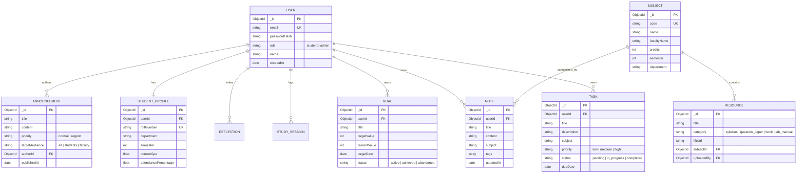

# Student Hub — Phase 2: Feature Inventory & Full-Stack Migration Plan

**Date:** October 25, 2026  
**Architect:** Senior Full-Stack & DevOps Architect  
**Candidate:** Abhimanyu Single Rathore (Roll No: `24ESKCS013`)  
**College Repository:** [skit-devops-2026/devops-24ESKCS013](https://github.com/skit-devops-2026/devops-24ESKCS013)  
**Personal Repository:** [Abhimanyu2211/student-hub](https://github.com/Abhimanyu2211/student-hub)  

---

## 1. Complete Existing Feature Inventory

The current repository contains **30 HTML pages**, **5 CSS stylesheets**, and **9 JavaScript client modules** under the UI brand *Student360*. Every feature below has been audited directly against source code in `auth/`, `student/`, `admin/`, and `js/`.

### 1.1 Public & Authentication Subsystem

| File Path | Page Title | Current Functionality | Existing Data Source | Planned React Route & Component | Required API Endpoints | Target MongoDB Model |
|---|---|---|---|---|---|---|
| [index.html](file:///Users/manoj/Desktop/fsd%20project/index.html) | Landing Page | Hero banner, feature overview, CTA links to auth. | Static HTML | `/` -> `LandingPage.tsx` | None (Static/Public) | None |
| [auth/login.html](file:///Users/manoj/Desktop/fsd%20project/auth/login.html) | Role Selector | Dual card chooser directing to Student vs Admin login. | Static links | `/login` -> `RoleSelectPage.tsx` | None | None |
| [auth/student-login.html](file:///Users/manoj/Desktop/fsd%20project/auth/student-login.html) | Student Login | Email & password form, client regex validation, password visibility toggle. | Mock session in `localStorage` (`s360_session`) | `/login/student` -> `StudentLoginPage.tsx` | `POST /api/v1/auth/login` | `User` |
| [auth/admin-login.html](file:///Users/manoj/Desktop/fsd%20project/auth/admin-login.html) | Admin Login | Staff ID / email & password, client validation, administrative routing. | Mock session in `localStorage` | `/login/admin` -> `AdminLoginPage.tsx` | `POST /api/v1/auth/admin-login` | `User` (role: `admin`) |
| [auth/student-register.html](file:///Users/manoj/Desktop/fsd%20project/auth/student-register.html) | Student Register | Full name, roll number, department, email, password, confirm password validation. | Mock session creation | `/register` -> `StudentRegisterPage.tsx` | `POST /api/v1/auth/register` | `User` & `StudentProfile` |

---

### 1.2 Student Academic Subsystem (16 Pages)

| File Path | Current Functionality | Existing Data Mechanism | Planned React Route & Component | Required API Endpoints | Target MongoDB Model |
|---|---|---|---|---|---|
| [student/dashboard.html](file:///Users/manoj/Desktop/fsd%20project/student/dashboard.html) | Academic ledger: attendance rate, GPA summary, urgent deadlines, recent notes, quick action modals. | Static markup + `localStorage` user name | `/student/dashboard` -> `StudentDashboard.tsx` | `GET /api/v1/student/dashboard-summary` | Aggregated from `Task`, `Goal`, `Subject`, `Attendance` |
| [student/tasks.html](file:///Users/manoj/Desktop/fsd%20project/student/tasks.html) | Kanban/List view of homework & assignments, status toggling (Pending, In Progress, Completed), priority tagging. | `js/tasks.js` (`localStorage`) | `/student/tasks` -> `TasksPage.tsx` | `GET /api/v1/tasks`<br>`POST /api/v1/tasks`<br>`PUT /api/v1/tasks/:id`<br>`DELETE /api/v1/tasks/:id` | `Task` |
| [student/goals.html](file:///Users/manoj/Desktop/fsd%20project/student/goals.html) | Semester milestones, target dates, progress percentage sliders, goal status tracking. | `js/goals.js` (`localStorage`) | `/student/goals` -> `GoalsPage.tsx` | `GET /api/v1/goals`<br>`POST /api/v1/goals`<br>`PATCH /api/v1/goals/:id` | `Goal` |
| [student/subjects.html](file:///Users/manoj/Desktop/fsd%20project/student/subjects.html) | Course cards: course code, credits, faculty name, attendance %, syllabus progress. | Hardcoded HTML cards | `/student/subjects` -> `SubjectsPage.tsx` | `GET /api/v1/subjects` | `Subject` |
| [student/subject-details.html](file:///Users/manoj/Desktop/fsd%20project/student/subject-details.html) | Subject deep-dive: unit breakdown, assignment list, faculty contact, syllabus download link. | URL query param mock display | `/student/subjects/:id` -> `SubjectDetailPage.tsx` | `GET /api/v1/subjects/:id` | `Subject`, `Resource` |
| [student/notes.html](file:///Users/manoj/Desktop/fsd%20project/student/notes.html) | Note catalog grid, filter by subject/tag, search bar, date sorting. | `js/notes.js` (`localStorage`) | `/student/notes` -> `NotesCatalogPage.tsx` | `GET /api/v1/notes` | `Note` |
| [student/note-editor.html](file:///Users/manoj/Desktop/fsd%20project/student/note-editor.html) | Markdown/WYSIWYG note editor, subject picker, auto-save status indicator. | `js/notes.js` (`localStorage`) | `/student/notes/edit/:id?` -> `NoteEditorPage.tsx` | `POST /api/v1/notes`<br>`PUT /api/v1/notes/:id`<br>`GET /api/v1/notes/:id` | `Note` |
| [student/calendar.html](file:///Users/manoj/Desktop/fsd%20project/student/calendar.html) | Monthly/weekly view of exam schedules, assignment due dates, college events. | Client JS DOM generation | `/student/calendar` -> `CalendarPage.tsx` | `GET /api/v1/calendar/events` | Aggregated from `Task` & `Announcement` |
| [student/study.html](file:///Users/manoj/Desktop/fsd%20project/student/study.html) | Pomodoro study timer (25/5 min), session subject selector, daily study duration logger. | `js/study.js` (`localStorage`) | `/student/study` -> `StudyTimerPage.tsx` | `GET /api/v1/study-sessions`<br>`POST /api/v1/study-sessions` | `StudySession` |
| [student/progress.html](file:///Users/manoj/Desktop/fsd%20project/student/progress.html) | Study hour graphs, subject-wise completion, weekly trends. | Hardcoded HTML metrics | `/student/progress` -> `ProgressPage.tsx` | `GET /api/v1/student/progress-metrics` | Aggregated metrics |
| [student/analytics.html](file:///Users/manoj/Desktop/fsd%20project/student/analytics.html) | Academic GPA trend, attendance percentages by subject, comparative cohort graph. | `js/analytics.js` | `/student/analytics` -> `StudentAnalyticsPage.tsx` | `GET /api/v1/student/analytics` | Aggregated `Attendance`, `Grade` |
| [student/reflection.html](file:///Users/manoj/Desktop/fsd%20project/student/reflection.html) | Weekly self-assessment journal (productivity rating, challenges, wins). | `localStorage` journal | `/student/reflection` -> `ReflectionPage.tsx` | `GET /api/v1/reflections`<br>`POST /api/v1/reflections` | `Reflection` |
| [student/resources.html](file:///Users/manoj/Desktop/fsd%20project/student/resources.html) | Library of past year question papers, lab manuals, e-books, slide decks. | Static cards with filter | `/student/resources` -> `StudentResourcesPage.tsx` | `GET /api/v1/resources` | `Resource` |
| [student/announcements.html](file:///Users/manoj/Desktop/fsd%20project/student/announcements.html) | Institutional bulletins, department notices, urgent holiday alerts. | Static card feed | `/student/announcements` -> `StudentAnnouncementsPage.tsx` | `GET /api/v1/announcements` | `Announcement` |
| [student/ai.html](file:///Users/manoj/Desktop/fsd%20project/student/ai.html) | Academic tutor chat interface with prompt suggestions and study advice. | `js/ai.js` mock responses | `/student/ai` -> `AiTutorPage.tsx` | `POST /api/v1/ai/query` (Local rule-engine or LLM) | `AiInteraction` (Audit log) |
| [student/profile.html](file:///Users/manoj/Desktop/fsd%20project/student/profile.html) | Profile information (Roll, Section, Email), password change, notification toggles. | Mock data | `/student/profile` -> `ProfilePage.tsx` | `GET /api/v1/users/me`<br>`PUT /api/v1/users/me` | `User`, `StudentProfile` |

---

### 1.3 Administrator Subsystem (9 Pages)

| File Path | Current Functionality | Existing Data Mechanism | Planned React Route & Component | Required API Endpoints | Target MongoDB Model |
|---|---|---|---|---|---|
| [admin/dashboard.html](file:///Users/manoj/Desktop/fsd%20project/admin/dashboard.html) | Overview KPIs: total enrolled students, low attendance warnings, active resources, quick broadcast modal. | Static metrics | `/admin/dashboard` -> `AdminDashboard.tsx` | `GET /api/v1/admin/dashboard-stats` | Aggregated |
| [admin/students.html](file:///Users/manoj/Desktop/fsd%20project/admin/students.html) | Searchable student database table, filter by semester/branch, status badges (Active, Defaulter). | `js/admin.js` DOM filter | `/admin/students` -> `AdminStudentsPage.tsx` | `GET /api/v1/admin/students`<br>`POST /api/v1/admin/students` | `User`, `StudentProfile` |
| [admin/student-details.html](file:///Users/manoj/Desktop/fsd%20project/admin/student-details.html) | Detailed profile, academic record, attendance record, disciplinary notes, parent contact. | URL query mock | `/admin/students/:id` -> `AdminStudentDetailPage.tsx` | `GET /api/v1/admin/students/:id`<br>`PUT /api/v1/admin/students/:id` | `User`, `StudentProfile`, `Attendance` |
| [admin/subjects.html](file:///Users/manoj/Desktop/fsd%20project/admin/subjects.html) | Course catalog management: add new course, assign faculty, update syllabus. | Modal form + mock table | `/admin/subjects` -> `AdminSubjectsPage.tsx` | `GET /api/v1/admin/subjects`<br>`POST /api/v1/admin/subjects`<br>`DELETE /api/v1/admin/subjects/:id` | `Subject` |
| [admin/resources.html](file:///Users/manoj/Desktop/fsd%20project/admin/resources.html) | Upload, curate, categorize, and delete syllabus/lab manuals. | Search, filter, modal | `/admin/resources` -> `AdminResourcesPage.tsx` | `GET /api/v1/resources`<br>`POST /api/v1/resources`<br>`DELETE /api/v1/resources/:id` | `Resource` |
| [admin/announcements.html](file:///Users/manoj/Desktop/fsd%20project/admin/announcements.html) | Create, publish, pin, and delete campus announcements with priority tags. | `js/admin.js` | `/admin/announcements` -> `AdminAnnouncementsPage.tsx` | `GET /api/v1/announcements`<br>`POST /api/v1/announcements`<br>`DELETE /api/v1/announcements/:id` | `Announcement` |
| [admin/ai-management.html](file:///Users/manoj/Desktop/fsd%20project/admin/ai-management.html) | AI tutor model configuration, rate limits, token usage analytics, subject boundaries. | Static mockup | `/admin/ai` -> `AdminAiSettingsPage.tsx` | `GET /api/v1/admin/ai-config`<br>`PUT /api/v1/admin/ai-config` | `SystemConfig` |
| [admin/settings.html](file:///Users/manoj/Desktop/fsd%20project/admin/settings.html) | Semester term dates, database backup triggers, session timeout config, system audit logs. | Static forms | `/admin/settings` -> `AdminSettingsPage.tsx` | `GET /api/v1/admin/settings`<br>`PUT /api/v1/admin/settings` | `SystemConfig` |
| [admin/analytics.html](file:///Users/manoj/Desktop/fsd%20project/admin/analytics.html) | Institutional analytics: branch-wise attendance, semester failure rates, platform engagement. | Canvas/SVG mock | `/admin/analytics` -> `AdminAnalyticsPage.tsx` | `GET /api/v1/admin/analytics` | Aggregated |

---

## 2. Target Full-Stack Architecture

### 2.1 Monorepo Folder Structure
```
fsd project/
├── client/                     # React + TypeScript + Vite
│   ├── src/
│   │   ├── api/                # Axios / fetch client with auth interceptors
│   │   ├── components/         # Reusable UI (Sidebar, Navbar, Modal, Toast, Cards)
│   │   ├── context/            # AuthContext, NotificationContext
│   │   ├── layouts/            # StudentLayout, AdminLayout, PublicLayout
│   │   ├── pages/              # 30 migrated page components
│   │   ├── types/              # Shared TypeScript definitions
│   │   ├── styles/             # Preserved CSS tokens & global design system
│   │   ├── App.tsx             # React Router route registry
│   │   └── main.tsx            # Vite entry point
│   ├── index.html              # Single page app container
│   ├── package.json
│   ├── tsconfig.json
│   └── vite.config.ts
├── server/                     # Node.js + Express + TypeScript
│   ├── src/
│   │   ├── config/             # DB connection, JWT secrets, environment validation (Zod)
│   │   ├── controllers/        # Request handlers (Auth, Task, Goal, Note, Admin)
│   │   ├── middleware/         # Auth verification, Role guard, Error handler, Rate limiter
│   │   ├── models/             # Mongoose schemas (User, Task, Goal, Note, Subject, etc.)
│   │   ├── routes/             # Express routers mapped to /api/v1/...
│   │   ├── services/           # Business logic & database aggregation
│   │   ├── types/              # Backend request/response interfaces
│   │   └── app.ts              # Express application factory & middleware stack
│   ├── src/server.ts           # HTTP server bootstrap & graceful shutdown
│   ├── package.json
│   ├── tsconfig.json
│   └── tests/                  # Jest / Supertest integration test suite
├── monitoring/
│   ├── prometheus.yml          # Scrapes Express backend at /metrics (prom-client)
│   └── dashboard.json          # Real Grafana dashboard importing backend metrics
├── k8s/
│   ├── deployment.yaml         # Aligned to GHCR image with health probes & resource limits
│   └── service.yaml            # LoadBalancer / ClusterIP service
├── Dockerfile                  # Multi-stage production build (build client -> run server + static)
├── docker-compose.yml          # Express app + MongoDB persistent container
├── Jenkinsfile                 # Validated multi-stage declarative pipeline
└── .github/workflows/ci.yml    # Build, test, lint, and container validation
```

---

## 3. MongoDB Data Schema Design



---

## 4. Phase-by-Phase Migration Strategy (Iterative & Non-Destructive)

```
[Phase 1: Security & Remotes]  <-- COMPLETED
        │
[Phase 2: Architecture Plan]   <-- COMPLETED
        │
[Phase 3: Scaffold Client & Server Core] <-- COMPLETED
        │
[Phase 4: Persistence, Auth & Role RBAC] <-- COMPLETED
        │
[Phase 5: Student Academic Features]     <-- COMPLETED (feature/student-academic-modules)
        │
[Phase 6: Admin Academic & Institutional Management] <-- COMPLETED (feature/admin-management-modules)
        │
[Phase 7: Comprehensive Automated Testing]           <-- READY FOR INITIATION
        │
[Phase 8: Docker Multi-Stage & Compose]
        │
[Phase 9: CI/CD & Registry Integration]
        │
[Phase 10: Prometheus Metrics & Grafana]
        │
[Phase 11: Kubernetes Realignment & Probes]
        │
[Phase 12: Production Evidence & Viva Prep]
```

---

## 5. Acceptance & Verification Criteria Checklist

- [x] **Security:** No plain-text tokens or credentials in `.git/config`, history, or code.
- [x] **Preservation:** The existing static HTML/CSS files remain untouched in the root until the React components in `client/` are verified.
- [x] **Authentication:** Passwords securely hashed with bcrypt; JWT session stored in secure `HttpOnly` cookie.
- [x] **Student Isolation:** Students cannot view, edit, or delete another student's tasks, notes, goals, or study sessions (enforced via DB query filters and verified with automated cross-user tests).
- [x] **Persistence:** Real MongoDB collections for `User`, `StudentProfile`, `Subject`, `Task`, `Goal`, `Note`, `StudySession`, `Announcement`, and `Resource`.
- [x] **Authorization:** Only users with `role: "admin"` can access `/api/admin/*`, `POST/DELETE /api/announcements`, and `POST/DELETE /api/resources`.
- [ ] **Docker:** Image compiles client assets and serves the app cleanly without leaking internal git or config files.
- [ ] **Observability:** Prometheus scrapes real `/metrics` (e.g. `http_requests_total`, `process_cpu_seconds_total`) from Express.
- [x] **Testing:** Automated test suite runs with 58 tests passing across 15 suites with zero failures.

---

## 6. Admin Subsystem Verification (10/10 Verified)

- [x] **Student cannot access admin APIs:** `/api/admin/students`, `/api/admin/stats`, status patches, and admin mutations return HTTP 403 Forbidden.
- [x] **Unauthenticated requests receive HTTP 401:** Missing or expired cookies reject with structured 401 error.
- [x] **Admin can search and paginate student records:** Supports regex search by name, email, or rollNumber; pagination with `page`, `limit`, `totalPages`, and `total`.
- [x] **Admin can update permitted student status fields:** Status transition between `'active'` and `'suspended'`; suspended accounts are blocked from login and active sessions; self-lockout prevention for requesting administrators.
- [x] **Announcements persist and obey publication rules:** Draft announcements are strictly hidden from students; published announcements respect expiration dates and target audiences (`all`, `students`).
- [x] **Resources persist and obey visibility rules:** Dangerous URL schemes (`javascript:`, `file:`, etc.) are strictly rejected; students see only published resources.
- [x] **Dashboard KPIs reflect actual database records:** Aggregated via live count and distinct queries across `User`, `Resource`, `Announcement`, `StudentProfile`, and `Subject`.
- [x] **Attendance-defaulter threshold is documented:** Documented configurable threshold (default `75%`); calculates unique affected students separately from total low-attendance course records.
- [x] **Backend authorization tests pass:** 24 dedicated admin and RBAC tests passing in `server/src/admin-features.test.ts`.
- [x] **React production build and hygiene checks pass:** TypeScript builds with 0 errors (`npm run build --prefix client`) and passes all repository test scripts.
